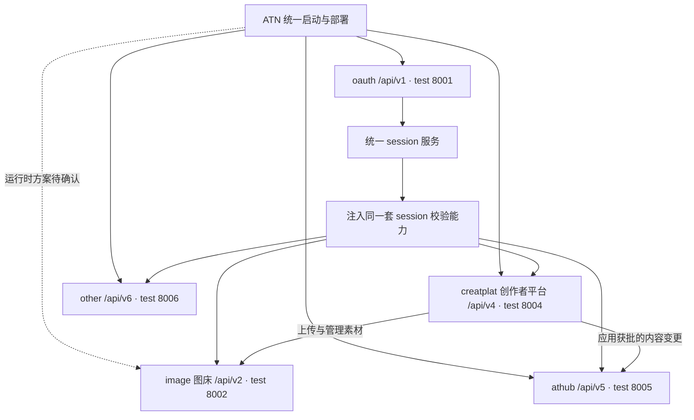

# ATN 五模块后端重构计划

更新日期：2026-11-16  
适用项目：`D:\AlbaTextus\atnexus`  
状态：规划文档，尚未实施代码、接口或数据库变更。

## 1. 本轮确定的方向

后端按 oauth、image、creatplat、athub、other 五个业务模块分别存放和维护，统一启动、构建与发布。本地 test 环境为每个模块分配端口及固定 API 前缀。

取消独立的 library 模块，书库与正式内容能力保留在 ATHub。creatplat 是创作者平台，统一负责审核、历史和修订。image 是图床，以工作区根目录现有 `D:\AlbaTextus\imgbed` 项目为迁移来源。

OAuth 负责统一登录和 session 签发，其他模块使用同一套 session 校验能力。用户登录一次后访问已获授权的模块，不需要各模块重复登录。

本轮工作集中于目录划分、路由迁移、统一认证、现有图床接入与本地联调，不开展模块单独部署、独立镜像发布、分库或拆仓库。Go 模块通过进程内接口装配；图床使用不同运行时，接入方式需按第 4.3 节确认后确定，不能直接宣称五模块已能运行于同一个 Go 进程。

## 2. 模块、API 与本地 test 端口

| 模块目录 | 模块名 | API 前缀 | 本地 test 后端端口 | 本地请求入口 |
| --- | --- | --- | --- | --- |
| `modules/oauth/` | oauth | `/api/v1` | `8001` | `http://localhost:8001/api/v1` |
| `modules/image/` | image | `/api/v2` | `8002` | `http://localhost:8002/api/v2` |
| `modules/creatplat/` | creatplat | `/api/v4` | `8004` | `http://localhost:8004/api/v4` |
| `modules/athub/` | athub | `/api/v5` | `8005` | `http://localhost:8005/api/v5` |
| `modules/other/` | other | `/api/v6` | `8006` | `http://localhost:8006/api/v6` |

约定：

- 删除 library 的模块、监听器及配置项。其余模块沿用上一版编号和端口，`/api/v3`、`8003` 暂不分配；本轮不自动将后续模块向前重编号。
- 按用户指定保留 `creatplat` 拼写，不自行改名。
- 本计划中的 v1—v6 表示模块 API 分区；同一业务的新旧接口不能通过任意占用其他模块编号来区分。
- 每个监听器只挂载对应模块的业务路由，例如 `8002` 挂载 `/api/v2/*`，不因它们同属一个进程就同时暴露全部模块。
- 主服务统一管理已接入的模块；端口划分便于本地调试，不表示按模块单独部署。image 的端口归属由确认后的运行时接入方式落实。
- 表中地址是本地 test 配置目标，实际监听地址和前端入口由环境配置读取，不写死在业务代码中。
- 生产环境域名、端口暴露和反向代理方式另行配置；不直接将本地 test 端口定义为生产公开端口。

## 3. 模块职责与待确认边界

目录、API 前缀、test 端口以及创作者平台、图床的主要职责已经明确，具体旧接口按下列边界登记迁移。

| 模块 | 当前可明确的范围 | 实施前需确认的事项 |
| --- | --- | --- |
| oauth | 账户、注册登录、session 签发与撤销、用户资料、角色、第三方登录、Passkey、邮箱验证、OAuth 应用与授权 | 现有协议文档和站点设置是否继续归此模块 |
| image | 图床：复用根目录现有 imgbed 的上传、文件管理、分类、本地文件和 S3 兼容存储能力 | 不重新发明图床业务；先确认 Node.js 运行时如何接入统一后端，以及旧文件 URL 的兼容方案 |
| creatplat | 创作者平台：投稿与待审变更、审核流程、修订记录、贡献历史及相关查询和管理 | 审核、历史、修订统一由此模块维护；通过明确接口调用 ATHub 正式内容能力和 image 素材能力 |
| athub | 书库与正式内容：平台、作者、标签、小说、卷、章节、已发布插图关联等查询和存储；现有 Key、额度和调用统计先归内容访问管理 | 将现有审核、历史、修订业务迁出到 creatplat；不再建立 library 模块，不重复实现创作者工作流 |
| other | 预留 `/api/v6` 的 other 业务分区 | 具体要收纳的业务清单；不自动接收其他模块中难以归属的逻辑 |

**正式内容归 ATHub，审核、历史、修订归 creatplat，图片文件与存储归 image，登录身份归 OAuth。** 一份业务数据由一个模块负责，其他模块通过接口使用。

例如：创作者向 creatplat 提交修订，creatplat 判断提交与审核权限；通过审核后调用 ATHub 应用正式内容变更，记录执行结果和修订历史。图片字节与存储元数据交给 image，ATHub 保存正式内容所需的图片关联。ATHub 的数据库事务和内容执行回执属于底层执行保障，不因此另建一套审核或历史业务。

新模块如果尚无已确认业务，只登记模块信息和预留接口分区。待公共装配阶段可接入基础状态检查，但不生成虚构业务 API 或假数据，也不把该模块标记为业务已完成。

现有 Credit 等外部服务保持边界。image 的迁移来源已明确为根目录 imgbed；本轮只规划模块化接入，不移动其工作树、运行数据或存储文件。

## 4. 目标代码组织

```text
atnexus/
├─ cmd/
│  └─ server/                 # 唯一后端启动入口
├─ internal/
│  ├─ bootstrap/              # 模块构造、依赖注入、初始化顺序
│  ├─ server/                 # Go 模块监听器、公共中间件与优雅退出
│  └─ config/                 # 统一读取环境配置并分发模块配置
├─ modules/
│  ├─ oauth/
│  ├─ image/                  # 来源为根目录现有 imgbed
│  ├─ creatplat/               # 创作者平台：审核、历史、修订
│  ├─ athub/                  # 书库及正式内容
│  └─ other/
├─ pkg/
│  ├─ auth/                   # 最小身份类型、session 校验契约
│  └─ httpx/                  # 确有复用需要的 HTTP 基础工具
├─ prisma/                    # 保留现有账户库完整迁移链
├─ scripts/                   # 统一检查、构建与打包
├─ web/                       # 现有前端，更新 API 接入
├─ temp/                      # 临时脚本、验证记录、日志
├─ release/                   # 打包与发布生成文件
└─ atnpan-ban.md
```

模块内部采用相近结构，按实际业务复杂度设置，不为统一形式增加无用途的空层级：

```text
modules/<module>/
├─ module.go                  # 模块构造、路由入口、资源释放
├─ config.go                  # 模块配置和校验
├─ api/                       # 请求、响应与路由
├─ service/                   # 业务规则
├─ repository/                # 数据访问
├─ types/                     # 模块业务类型，按需建立
└─ README.md                  # 职责、接口、依赖和数据归属
```

这是目标组织示意。现有 ATHub 的 `internal/api`、`internal/storage` 可先保留，不为目录命名一致额外重写存储层。

### 4.1 业务模块与 Go module

“一个业务模块一个文件夹”不等于必须各有一个 `go.mod`。

推荐本轮新增 Go 模块先由根 `go.mod` 管理；现有 ATHub 的独立 `go.mod` 和本地 `replace` 暂时保留，减少无关变更。不批量新增依赖清单，也不将模块独立构建、独立发布作为本轮要求。image 现为 Node.js 项目，不能套用新增 Go 模块的处理方式。

因 ATHub 仍是独立 Go module，共享的 `auth` 契约需使用它能合法导入的稳定包路径。宿主将 OAuth 校验实现适配给模块；必要时在模块侧定义最小消费接口。不得让 ATHub 导入宿主 `internal/*`，也不复制整套认证实现。

### 4.2 依赖规则

- 主服务可以装配所有模块；模块不能反过来依赖启动入口。
- 业务逻辑放在所属模块内，不继续堆积到根 `internal/httpapi`、`internal/store`。
- 模块间通过明确的进程内能力接口调用，不直接访问对方内部实现或任意操作对方数据表。
- OAuth 负责身份事实；各业务模块负责自身的权限、资源状态和额度，创作相关审核、历史与修订规则集中在 creatplat。
- 公共 auth 包只维护身份契约与请求上下文，不保存账户密码或承载 OAuth 业务实现。
- other 也要有明确业务清单，不作为无法归类代码的默认去处。

### 4.3 现有图床的接入前提

已核对 `D:\AlbaTextus\imgbed\package.json`、`deploy/server/index.js` 及存储文档：

- 当前图床使用 Node.js 24、Hono，数据库为 SQLite，文件存储使用本地目录或 S3 兼容服务。
- 已有 API 上传、文件管理、分类、头像/背景/封面/插图分类接口，不需要从零重做图床产品。
- 当前图床通过 OAuth 授权后建立自己的图床登录会话，不等于直接认可 ATN session；接入后需要改造为统一认证。
- 已有 SQLite 数据、文件 ID、本地数据目录、对象存储键和文件 URL 都是迁移资产，不应在整理目录时重新初始化或丢弃。

正式实现 image 前需要确定运行方式：

| 选项 | 接入方式 | 对本轮目标的影响 |
| --- | --- | --- |
| 保留 Node.js 实现 | 将所需图床代码纳入 image，统一启动和打包管理 Node.js 运行时，补齐可信身份传递与统一 session 校验 | 业务复用较多，但会形成统一部署下的多进程运行，需定义内部调用与退出管理 |
| 迁为 Go 模块 | 以现有图床功能和数据为依据迁移实现，嵌入 ATN Go 主服务 | 可达到单进程直接调用，但增加 SQLite、本地/S3 存储和图床接口迁移工作量 |

两个选项均保持统一部署。当前只确定图床来源与业务归属，不替用户选择运行时方案。确认前，不新增占位图床实现，也不把“复制目录”计为接入完成。

## 5. 统一运行与装配流程



启动顺序：

1. 读取环境和模块注册配置，核验端口、前缀及依赖，重复或缺失时给出明确错误。
2. 初始化现有数据库和必要基础资源，先构造 OAuth 身份与 session 服务。
3. 向业务模块注入同一 session 校验能力以及已明确的其他业务依赖。
4. 构造各模块路由，按表中映射挂载到各自监听器。
5. Go 宿主先绑定自身管理的已启用端口，再开始服务；若 image 保留 Node.js，由统一启动器协调子进程就绪与端口检查，失败时同样释放已创建资源。
6. 接收退出信号后统一停止接收请求、等待在途操作、关闭模块和连接池。

Go 模块不自行读取进程信号、不调用 `os.Exit`、不自行启动额外 HTTP 服务，跨模块调用走进程内接口。image 如果保留 Node.js，其启动、就绪、停止以及跨运行时调用方案需补充设计，不能套用 Go 进程内调用说明。

业务尚未确认的 other 可先预留注册信息；到五模块装配验收时，已启用分区都应准确报告能力状态。无业务模块不能用成功状态的虚构接口代替未实现能力。

## 6. OAuth 统一 session 认证

### 6.1 session 的所有权

OAuth 统一负责登录认证、session 创建、到期和撤销；其他模块不创建自己的登录 session。

session 使用服务端存储的不透明随机凭证，沿用现有凭证哈希存储思路。浏览器通过 HttpOnly Cookie 携带 session，业务模块使用宿主注入的 OAuth 校验器取得可信身份。

上述进程内校验适用于 Go 模块。若 image 保留 Node.js，需另行实现由 OAuth 权威校验 session 的受保护适配通道；不能继续签发图床独立登录会话，也不能信任浏览器自填的用户或角色请求头。

“分发 session”在本计划中指各模块认可同一 session，而不是复制会话表、将 session 明文广播给模块，或让前端手动拼接用户身份。

### 6.2 请求校验流程

1. 用户在 OAuth 登录，OAuth 创建 session 并设置 Cookie。
2. 浏览器访问业务模块时携带同一 Cookie。
3. 公共认证中间件调用 OAuth 的进程内校验能力。
4. 校验 session 存在、未过期、未撤销，并检查账户当前是否启用。
5. 将用户 ID、session ID、必要角色及有效期写入可信请求上下文。
6. 模块根据身份执行本模块的权限和资源归属检查。

只需可信身份的模块读取上下文即可，不查询或修改账户库 session 表；敏感写入涉及状态并发时，保留原有必要事务校验，不能用请求开始时的身份快照代替所有业务授权。

统一错误语义：

| 情况 | 响应 |
| --- | --- |
| 缺少、失效或已撤销 session，或账户已禁用 | `401` |
| session 有效但缺少业务权限 | `403` |
| session 存储等必要依赖故障，无法确认身份 | `503`，不继续执行业务 |

错误结构统一维护，各模块不要分别定义不同的未登录判断。API 返回认证错误，由前端协调跳转登录页，不把登录 HTML 当成业务接口响应。

### 6.3 本地跨端口 Cookie 与 CORS

Cookie 按主机和路径等属性匹配，不按端口隔离。因此同一主机下表中五个模块端口可以共享 OAuth session；跨端口请求仍然需要正确处理 CORS，空出的 `8003` 不需要启动服务。

- 本地前后端统一使用配置中的同一种主机名，不混用 `localhost` 与 `127.0.0.1`。
- session Cookie 的 Path 使用 `/`，覆盖五模块使用的各个 API 分区。
- 本地同主机使用 host-only Cookie 即可，不为跨端口共享扩大 Domain 范围。
- 前端访问各模块时显式携带凭据，例如请求配置采用 `credentials: include`。
- 各监听器只允许配置中的前端 Origin，开启凭据支持时不能用通配符 Origin。
- OPTIONS 预检应在会话校验前处理，不要求 session、不执行业务或额度记账。
- 根据环境配置 Secure、SameSite 等 Cookie 属性，保持 HttpOnly；正式 HTTPS 环境使用安全配置。
- 使用 Cookie 的修改请求统一执行已有 CSRF/来源校验策略，并扩展到全部业务模块。不能仅开启 CORS 就视为已防护 CSRF。

前端 JS 不读取 session 明文，不将它写入 localStorage，不为每个模块另建登录 token。

### 6.4 退出、封禁与缓存

- OAuth 退出登录、管理员撤销会话和账户禁用后，后续受保护模块请求都应拒绝，不能只影响 `8001`。
- 现有可选 Redis session 缓存继续由 OAuth 管理；各模块不各建一份授权状态缓存。
- 迁移时保留并验证缓存版本、撤销失效及账户状态检查；不能仅验证 Cookie 格式就放行。
- 必须验证会话缓存失效失败等情况下的撤销一致性，不能只依靠 TTL 宣称立即退出生效。
- 已通过准入的在途请求与后续新请求区分，保持已明确的并发执行规则。

### 6.5 现有 Key、只读凭证和 OAuth 令牌

本轮站内五模块采用统一 session，不再为站内访问新增 ATHub 专用短时凭证或图床独立登录会话这一层依赖。

现有 ATHub 个人 API Key、只读凭证和外部 OAuth 接入已经承担不同用途。迁移清单中应分别登记：站内调用切换到 session；外部 Key 是否继续提供、旧只读凭证何时停用，需要另行确认。确认前保留现有数据，不自动重置 Key、删除接口或把 OAuth access token 当成 session。

OAuth 原有授权协议能力继续保留，不因站内统一 session 而删除第三方应用的授权流程。

## 7. 路由迁移与旧接口冲突

当前系统的 ATHub 内容使用 `8003/api/v2/*`，历史与贡献者使用 `8003/api/v3/*`，部分 ATHub 管理接口位于 `8001/api/v1/*`。新规划改变了模块与前缀的归属，不能直接搜索替换版本号。

### 7.1 必须登记的迁移项

| 当前入口 | 新规划下的处理 |
| --- | --- |
| 账户、登录、session 的 `/api/v1/*` | 继续归 OAuth，端口 `8001` |
| `/oauth/*`、`/.well-known/oauth-authorization-server` | 继续由 OAuth 的 `8001` 监听器处理，保留标准协议路径；不强行改到 `/api/v1` 下 |
| `8003/api/v2/*` 的现有内容业务 | 正式内容读写迁到 ATHub 的 `8005/api/v5/*`；提交待审变更的入口归 creatplat |
| `8003/api/v3/history`、`/contributors` | 历史、修订与贡献记录查询迁到 creatplat 的 `8004/api/v4/*` |
| `8001/api/v1/account/athub/*`、`/admin/athub/*` | 投稿、审核、历史、修订归 creatplat；内容 Key/额度/调用统计先归 ATHub；按具体路径登记 |
| 根目录 imgbed 的现有接口 | 图床上传、文件管理和分类接口迁入 image 的 `8002/api/v2/*`；现有文件分发 URL 单独处理兼容 |

### 7.2 兼容与切换规则

- 迁移表至少记录旧端口、旧路径、HTTP 方法、调用方、目标模块、新路径、认证方式和停用条件。
- 优先同步更新本地前后端配置与调用；是否给外部调用方保留兼容期，需依据真实调用清单确认。
- 若保留旧路由，只作为明确登记的临时适配，复用新业务服务，不维护两套实现，也不依赖跨端口 302 跳转迁移写请求。
- 同一端口、方法和路径只能有一个所有者。取消 library 后不再创建新的 `8003` 监听；旧 `8003` 入口是否临时保留，只按兼容清单明确处理。
- 如果旧路由与新业务完全冲突，必须明确选择切换窗口或其他临时入口；不能把同一请求同时分配给两个模块。
- 兼容路由与模块正式分区分开登记，避免旧 ATHub v2 路由占用新 image 的 v2 业务入口。
- `Location`、分页链接、错误中的可操作 URL、前端 API 客户端和环境示例都要同步检查。
- 图床已有文件地址可能被账户头像、小说封面及外部调用方长期引用。API 改为 v2 不代表文件 URL 也可以直接替换；应保留旧地址访问或提供明确兼容映射，并验证本地文件与 S3 对象都能读取。

## 8. 数据与已有业务保护

本轮以业务代码归属和接口调整为主，保持现有数据库物理结构。五个模块不要求对应五个数据库；现有 PostgreSQL 内容/账户库与图床 SQLite、本地文件和 S3 存储分别保留。

- 账户、密码、OAuth、session 由 OAuth 管理，业务模块通过身份接口使用账户信息。
- 正式内容、内容 Key、额度和调用记录归 ATHub；审核、历史与修订数据归 creatplat；图片文件与存储元数据归 image。代码所有权迁移不要求同时搬迁物理数据。
- 现有根 `prisma/`、`modules/athub/prisma/` 以及 imgbed 的 SQLite 初始化与迁移历史保留，暂不因目录划分拆成五套迁移。
- 每张表明确唯一的迁移管理入口，不让不同模块并行改写同一张表的 schema。
- 不直接删减 Prisma schema 后执行可能删除旧表的迁移；不删除历史迁移、已有 ID、Key 哈希或真实审计数据。
- 共享旧库的过渡访问集中在明确适配层，不继续扩大模块间随意跨表访问。
- 当前审核与写入回执、投稿权限、额度并发控制、贡献者可信身份和历史 pending/completed 流程保留，不以目录整理为由重写其业务语义。
- 仍有跨库写入时，要按原有回执和历史确认流程处理失败；统一进程不等于跨库事务天然原子。
- 数据缺失明确返回缺失、空结果或未实现状态，不使用固定业务数据填补新模块。

### 8.1 创作者平台与正式内容的一致性

- creatplat 保存待审变更、审核决定、修订内容和贡献历史；ATHub 保存当前正式内容及必要执行回执。
- creatplat 调用 ATHub 时传递明确的变更命令、可信贡献者和稳定变更 ID，不允许客户端通过“已审核”标记绕过创作者平台。
- ATHub 生成真实内容差异或执行结果后，通过注入接口交给 creatplat 记录；现有 `RecordChanges` 可作为过渡适配，历史查询和业务维护入口归 creatplat。
- 保留原审核者/提交者权限检查、禁止自审、回执幂等及失败恢复；修订未应用成功前不能显示为正式内容已生效。
- 继续使用原跨库 pending/确认流程时，不把两次提交当成一个事务；崩溃或确认失败应保留可核对状态。
- 历史中缺失的旧贡献者、正文差异不补造。创作者平台可以管理修订记录，但当前正式章节不另复制一份作为第二内容源。
- 图片上传成功而内容变更未应用时，不直接把图片标记为正式内容已引用；清理未引用素材应有明确策略，不能误删历史或其他内容仍在使用的文件。

## 9. 配置与前端接入

### 9.1 后端配置

以下为待实施的配置命名建议，不表示当前代码已支持：

| 配置 | 本地 test 目标值 | 用途 |
| --- | --- | --- |
| `OAUTH_HTTP_ADDR` | `:8001` | OAuth 监听地址 |
| `IMAGE_HTTP_ADDR` | `:8002` | image 监听地址 |
| `CREATPLAT_HTTP_ADDR` | `:8004` | creatplat 监听地址 |
| `ATHUB_HTTP_ADDR` | `:8005` | ATHub 监听地址 |
| `OTHER_HTTP_ADDR` | `:8006` | other 监听地址 |

统一维护模块名、固定 API 前缀与配置读取位置，避免主服务、前端和文档各自维护不一致的映射。前缀属于路由契约，监听地址属于环境配置。

旧 `HTTP_ADDR` 到新 OAuth 配置提供清晰迁移说明。现有 `ATHUB_HTTP_ADDR` 默认对应 `8003`，新 test 配置调整为 `8005`；旧环境显式写出的 `8003` 不应静默被覆盖，应明确提示更新。`8003` 留空不再配置 library 监听器。

image 还需登记当前 `PORT`、`DATA_DIR`、SQLite 与 S3 配置的映射。实际存储路径、服务地址和密钥从配置读取，不复制开发环境的真实秘密或重置存储目录。

### 9.2 前端配置与请求

- API 客户端按模块选择入口，不再让一个 ATHub API 地址代表所有书库相关业务。
- 各模块地址来自前端环境配置，业务组件使用统一客户端，不直接拼写端口或散落重复前缀。
- 所有站内受保护请求统一携带 Cookie，统一处理 `401` 和 `403`；并发未登录响应合并处理，避免多模块同时反复跳转登录。
- session 变化后清理与旧用户关联的缓存，避免换号后显示前一个用户的数据。
- 书库及正式内容查询连接 ATHub，审核、修订和历史页面连接 creatplat，文件上传与管理连接 image；业务页面入口可以保留现有路径，不新增后端 library 模块。
- 用户页面、书库、投稿和后台只改接入所需逻辑，不顺带重做页面设计；默认验收桌面端。
- Next.js 构建时读取的公开配置变化后，需要重新构建并验证实际请求去向。

## 10. 分阶段实施计划

| 阶段 | 工作内容 | 验收条件 |
| --- | --- | --- |
| P0：核对迁移清单 | 以已明确的五模块职责登记现有路由、表和调用方；盘点 imgbed 并确认其运行时方案，登记 other 范围 | library 已移除；审核/历史/修订归 creatplat；图床接入方式和数据兼容范围明确 |
| P1：统一装配基础 | 整理模块构造与注册，增加五模块配置，删除 library 注册和配置，保留统一退出管理 | 统一入口管理已接入模块；端口/前缀冲突可检测；运行方式符合确认的图床方案 |
| P2：OAuth 与 session | 迁入账户认证业务，抽出统一 session 校验契约、中间件、身份上下文和 CORS/CSRF 策略 | 一次登录可访问其他模块；无效身份被拒绝；退出与禁用跨模块生效 |
| P3：分批迁移业务 | 将现有图床接入 image；正式内容收拢至 ATHub，审核/历史/修订迁入 creatplat，保留原规则和必要事务 | 两者职责无重复；图床真实文件可用；主服务仅负责装配；旧路由清单逐项完成 |
| P4：同步前端与配置 | 更新 API 客户端、模块入口、凭据携带、缓存和后台调用；处理旧接口及文件 URL 兼容 | 浏览器实际请求符合五模块映射，创作工作流、图床和正式内容流程完整 |
| P5：集成验收与统一发布 | 执行端口、认证、业务与数据库回归；更新统一构建和部署说明 | 统一后端产物可运行，已有功能和数据可用，文档与配置一致 |

P0 先确认图床运行时接入方式和真实迁移范围。Go 部分的 P1、P2 可先推进；image 的实现取决于第 4.3 节选择。当前阶段不增加模块单独部署、独立发布或数据库切换任务。

## 11. 验证清单

| 范围 | 必须验证的场景 |
| --- | --- |
| 路由与监听 | 五模块端口对应正确前缀；无 library 注册/监听；`8003` 除明确的旧兼容入口外不启用；其他模块路径不在错误端口暴露 |
| session 登录 | OAuth 登录后无需再次登录即可访问获授权模块；未登录、过期、撤销、封禁分别正确处理 |
| Cookie 与跨域 | 同主机跨端口携带 Cookie；预检通过；来源白名单和修改请求 CSRF 检查有效 |
| 统一授权 | 有效 session 不自动获得管理员或其他用户资源权限；角色变化与模块专属限制得到执行 |
| session 缓存 | Redis 关闭/启用、退出、管理员撤销、缓存失效失败时的正确性 |
| 现有账户和 OAuth | 注册、邮箱、密码、第三方登录、Passkey、授权确认、PKCE、令牌轮换及撤销 |
| 创作者平台与 ATHub | 投稿、审核、自审限制、修订、历史查询、正式内容应用与回执；失败不重复应用，历史只由 creatplat 维护 |
| 图床 | 原 SQLite 元数据、本地文件/S3、分类接口、上传、权限、旧文件 URL 与统一 session；退出后管理请求失效 |
| 内容访问 | ATHub 查询、内容 Key、额度、调用记账和原有权限限制 |
| 旧接口 | 调用方切换完成；兼容请求不重复执行；v2/v3 旧路由不与新模块分区混淆 |
| 运行生命周期 | 任一必要端口被占用时释放资源，正常启动、SIGTERM 优雅退出、依赖异常有准确状态 |
| 构建与数据 | 根模块及保留的嵌套 Go module 均被检查；现有迁移链和真实数据完整 |

沿用现有测试，对新增跨模块认证、路由隔离和迁移行为补充必要测试。数据库集成验证明确记录执行与跳过情况，不用编译成功代替真实 session 和业务验收。

存活/就绪检查由宿主按各模块依赖提供；保留必要协议入口及健康检查是明确例外，不受业务 API 前缀限制。未接入业务的模块应明确返回未实现或不可用，不返回伪造的业务成功结果。

## 12. 本轮完成标准

- 五模块目录、API 分区和本地 test 端口与第 2 节一致；library 已移除，其余编号保留。
- 后端统一启动、统一构建和统一发布，主服务负责监听与生命周期。
- Go 业务在各自模块维护，通过明确进程内接口提供跨模块能力；image 按已确认的运行时方案接入统一启动与发布。
- OAuth 唯一签发站内 session，各模块认可并校验同一 session。
- 跨端口 Cookie、CORS、CSRF、退出、撤销与账户状态检查经过实际验证。
- ATHub 维护正式内容，creatplat 负责审核、历史和修订，image 复用现有图床能力，不重复维护同一业务。
- 旧内容 API、历史 API 和账户中的业务接口有明确迁移记录；前端及真实调用方同步切换。
- 现有数据库、账号、认证资料、审计和历史保留，未因重构伪造或丢失数据。
- 尚未确定或尚未实现的模块能力如实登记，不将预留目录视为功能完成。

正式实施前仍需确认：**现有 Node.js 图床采用统一启动的保留方案，还是迁成 Go 模块；other 的具体业务清单；旧外部 Key/接口与文件 URL 的兼容范围。** library 取消、创作者平台负责审核/历史/修订、image 来源于现有图床以及统一 session 的方向均已明确，不再列为待确认。
